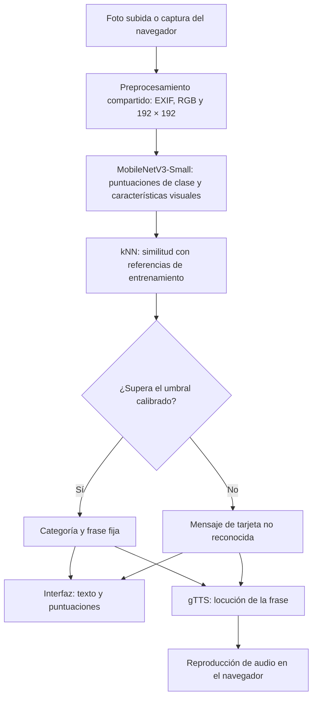

# Pictovoz: reconocimiento de pictogramas

Pictovoz es un prototipo de aplicación que reconoce fotografías de diez
pictogramas y las convierte en frases escritas y habladas. Por ejemplo, al
identificar la tarjeta **agua**, muestra **«Quiero tomar agua»** y genera su
locución en español. Se ejecuta en una computadora y se utiliza desde un
navegador.

## ¿Qué problema intentamos resolver?

Un pictograma es una imagen sencilla que representa una idea, una acción o una
necesidad. Las personas con dificultades para comunicarse mediante el habla
pueden utilizar estas imágenes como apoyo para expresar lo que necesitan.
El proyecto explora cómo facilitar el paso de una tarjeta visual a un mensaje
que otra persona pueda leer o escuchar.

El desafío técnico tiene dos partes: reconocer la tarjeta aunque cambien la
luz, el fondo, la distancia o la perspectiva, y evitar atribuir un significado
conocido a una imagen ajena al vocabulario. Una clasificación incorrecta puede
producir una frase distinta de la que se quería comunicar; por eso se evalúan
por separado el reconocimiento y el rechazo de imágenes desconocidas.

El alcance actual es un **producto mínimo viable (MVP)**: una versión funcional
para comprobar la propuesta con un vocabulario acotado. Su utilidad como apoyo
a la comunicación todavía requiere validación con usuarios; no se ha demostrado
eficacia clínica.

## ¿Qué permite hacer?

- Subir una fotografía o capturar una imagen con la cámara del navegador.
- Reconocer **agua, comer, baño, mamá, dolor, papá, no, sí, jugar y ayuda**.
- Mostrar una frase fija asociada a la categoría, como «Necesito ayuda» o
  «Quiero ir al baño», y reproducirla en voz alta.
- Informar que la tarjeta no fue reconocida cuando no supera el criterio de
  similitud con los ejemplos conocidos.
- Consultar las puntuaciones propuestas por el modelo para cada categoría.

Se trabaja con una tarjeta por imagen. La aplicación no construye mensajes
combinando varias tarjetas. La pestaña «Cámara en Vivo» vigente permite
**capturar una imagen y presionar el botón de identificación**.

## Estado actual

Estado revisado al **23 de octubre de 2026**. La aplicación activa usa
`MobileNetV3-Small` a 192 × 192 píxeles, con diez
clases y un detector kNN coseno de cinco vecinos. La configuración vigente es
[`config/application.json`](config/application.json); no usar
[`config/selected_model.json`](config/selected_model.json), que se conserva
solo como respaldo histórico.

El paquete seleccionado es `mobilenet_app_192_20261020`: un modelo propio de
la aplicación, entrenado después de comparar alternativas durante el desarrollo.
La prueba final independiente `s007` se realizó el **21 de octubre de 2026**:

- 291/300 pictogramas conocidos correctamente clasificados (97 %);
- 0/300 conocidas rechazadas;
- 29/50 entradas desconocidas rechazadas (58 %).

Esto significa que hubo nueve errores de clasificación conocidos y que 21
imágenes desconocidas fueron aceptadas incorrectamente. **El 97 % corresponde
solo a las 300 imágenes de categorías conocidas**, no a cualquier imagen que
reciba la aplicación.

### Objetivos cumplidos

- Vocabulario de diez categorías, dataset documentado y preparación reproducible
  con controles de sesiones y hashes para detectar duplicados exactos.
- Entrenamiento y comparación de una red convolucional compacta y
  MobileNetV3-Small, con experimentos a 128 y 192 píxeles.
- Aplicación local integrada con carga de fotos, captura por cámara, frases y voz.
- Modelo seleccionado con detector de rechazo calibrado en validación interna.
- Evaluación final separada del entrenamiento y la calibración, con métricas por
  clase, matriz de confusión y predicciones conservadas como evidencia.
- **Mínimo académico de 70 % de exactitud en conocidas superado** en la prueba
  final: 291 aciertos sobre 300 imágenes.

### Objetivos pendientes y límites

- **El rechazo de desconocidos no alcanza el objetivo del 70 %**: obtuvo 58 %
  en la prueba final. La calibración interna al 80 % tampoco se reprodujo allí.
- Falta validar el flujo completo con la cámara física de un celular y medir
  su comportamiento en condiciones reales de uso.
- Una sesión final y 50 desconocidas no permiten generalizar a todos los
  diseños de tarjetas, personas o dispositivos. Los negativos evaluados se
  concentran principalmente en objetos y escenas.
- No se ha validado la utilidad comunicativa con usuarios ni el uso clínico.
  ESP32-CAM, aplicación móvil nativa, API remota propia y despliegue en la nube
  quedan como posibles extensiones.

Para métricas, límites y evidencia, consultar
[la prueba final](docs/prueba_final_s007.md) y
[el estado actual](docs/estado_actual.md).

## Arquitectura y funcionamiento

El proyecto separa la interfaz, el procesamiento de imágenes, la inferencia y
los experimentos de entrenamiento. El reconocimiento se ejecuta en la
computadora que aloja la aplicación; el navegador presenta la interfaz.



Los componentes principales están en `src/reconocimiento_pictogramas/`:

- **Interfaz (`ui.py`)**: Gradio organiza foto, captura, identificación y
  reproducción. Limpia resultados anteriores cuando cambia la imagen o falla
  la inferencia. `accessible_theme.py` define la presentación visual.
- **Preprocesamiento (`preprocessing.py`)**: Pillow corrige orientación EXIF,
  convierte a RGB y redimensiona con LANCZOS. La entrada al modelo es `uint8`
  de 0 a 255; la normalización específica está dentro del modelo.
- **Inferencia (`inference.py`)**: TensorFlow/Keras carga el modelo, comprueba
  integridad y compatibilidad, y obtiene puntuaciones para las diez clases y
  características visuales de la imagen.
- **Rechazo (`feature_rejection.py`)**: compara las características con 1.800
  referencias de entrenamiento y calcula la similitud con los cinco vecinos
  más próximos. Una similitud menor o igual a `0.8024037084471637` rechaza la
  entrada. Esa similitud no es una probabilidad de acierto; una puntuación alta
  de clase tampoco garantiza aceptación.
- **Frases y voz (`config/communication.json` y `speech.py`)**: cada categoría
  tiene una frase predefinida. gTTS genera un MP3 temporal y reutiliza la
  locución durante la ejecución. Si falla la voz, se conserva el resultado
  escrito. El servicio externo recibe la frase; no recibe la imagen.
- **Entrenamiento y evaluación (`scripts/` y `cross_validation.py`)**: preparan
  datos, construyen rondas separadas por sesión y conservan modelos, predicciones,
  curvas y métricas. Este proceso se ejecuta por separado; usar la aplicación
  no vuelve a entrenar el modelo ni incorpora capturas al dataset.

`config/application.json` controla el paquete activo, su resolución, el orden
de clases y el detector. `config/project.json` conserva la configuración
histórica de preparación a 128 × 128; no define el tamaño de la aplicación
actual. `config/selected_model.json` es un respaldo histórico.

El repositorio conserva además utilidades de video continuo en `live.py` y
`camera_widget.py`. La interfaz vigente construida por `build_app()` usa
capturas individuales: esas utilidades no implican que el seguimiento continuo
esté activo en el flujo actual.

## Requisitos

- Python 3.11 (la versión fijada está en [`.python-version`](.python-version)).
- [uv](https://docs.astral.sh/uv/).
- Los artefactos locales del modelo: el checkpoint y las referencias indicados
  en [`config/application.json`](config/application.json). Están ignorados por
  Git y deben restaurarse desde un respaldo seguro antes de usar la aplicación.

## Instalación y comprobación

Desde PowerShell:

```powershell
git clone https://github.com/Sabri-Nang/reconocimiento-pictogramas.git
cd reconocimiento-pictogramas
uv sync --locked
uv run python --version
uv run python scripts/validate_config.py
uv run pytest -v
```

`validate_config.py` comprueba la compatibilidad de las configuraciones del
dataset y la aplicación; no audita las imágenes ni carga el checkpoint.
Las pruebas automatizadas tampoco sustituyen la evaluación del modelo real.

## Ejecutar la aplicación

```powershell
uv run reconocimiento-pictogramas
```

Abrir <http://127.0.0.1:7860> y seguir estos pasos:

1. En **Subir Foto**, elegir una imagen JPEG o PNG. También se puede entrar en
   **Cámara en Vivo**, permitir el acceso y capturar una imagen.
2. Mostrar una sola tarjeta, completa, enfocada y con buena iluminación.
3. Presionar **Identificar Pictograma**.
4. Leer la frase y escuchar su locución. Si el navegador bloquea la reproducción
   automática, usar el botón de audio.
5. Cambiar la imagen o utilizar **Limpiar imagen y resultado** para otra consulta.

El reconocimiento visual es local. La generación de voz usa gTTS y requiere
Internet cuando la frase todavía no está en la caché de la ejecución.

La aplicación verifica hashes, orden de clases, dimensiones del checkpoint y
referencias del detector antes de inferir. Si se cambia la configuración o el
umbral, reiniciar el servidor porque la carga está cacheada.

Para usar la cámara desde un celular se necesita HTTPS confiable y permiso del
navegador. La cámara trasera es una preferencia, no una garantía. La validación
física en dispositivos móviles sigue pendiente.

## Datos y preparación

Los originales viven en `data/raw/` y no deben sobrescribirse. La partición de
referencia es explícita:

- entrenamiento: `s001` a `s005`;
- validación interna: `s006`;
- prueba final reservada: `s007`;
- sesión suplementaria de desarrollo: `s008`.

Para validar las imágenes conocidas, nombres, hashes, cantidades y metadata sin
modificar archivos:

```powershell
uv run python scripts/prepare_dataset.py
```

El comando valida también `s008`, pero sus archivos no se añaden a los
manifiestos base de `data/splits/`; los experimentos de siete sesiones usan el
manifiesto específico conservado en `reports/`. Para regenerar los derivados
base de 128 × 128 y los manifiestos, tras revisar el alcance de la escritura:

```powershell
uv run python scripts/prepare_dataset.py --apply --workers 4
```

Los desconocidos no son una undécima clase. Se auditan por separado y nunca se
usan para entrenar el clasificador. Consultar
[el protocolo del dataset](docs/protocolo_dataset.md) antes de cambiar datos o
sesiones.

El modelo activo amplía la partición base: se entrenó con `s001`–`s005` y `s008`
(1.800 conocidas). `s006` aportó 300 conocidas para seleccionar el checkpoint y
50 desconocidas para calibrar el rechazo. `s007` se mantuvo aislada hasta la
prueba final de 300 conocidas y 50 desconocidas.

## Entrenamiento y evaluación

No ejecutar entrenamientos para comprobar una instalación. Cada experimento debe
usar un identificador nuevo, conservar sus artefactos y mantener `s007` fuera de
la selección de arquitectura, épocas y umbrales.

La validación cruzada actual de desarrollo usa `s001`–`s006` y `s008`:

```powershell
uv run python scripts/train_cross_validation.py --config config/cv_s008_128.json --run-id ID_NUEVO
uv run python scripts/describe_cv_results.py --run-id ID_NUEVO
```

Los resultados de validación cruzada son de desarrollo; no reemplazan la prueba
final. En las siete rondas, cada una entrena con cinco sesiones, valida
internamente con una y evalúa con otra: 1.500/300/300 imágenes conocidas. La
sesión interna selecciona el checkpoint por menor pérdida de validación; la
externa se evalúa después de esa selección.

Como antecedente de desarrollo, MobileNet192 obtuvo 1.964/2.100 aciertos
(93,52 %), frente a 1.777/2.100 (84,62 %) de MobileNet128. La CNN compacta
obtuvo 77,95 % a 128 y 70,33 % a 192. Estos resultados comparan procedimientos
en desarrollo y no son el rendimiento del paquete único de la aplicación. En
la CNN, cambiar resolución también cambió la cantidad de parámetros por su
capa `Flatten`; la diferencia no puede atribuirse exclusivamente al tamaño.

Los procedimientos, comparaciones 128/192 y límites de calibración están
en [la documentación de validación cruzada](docs/validacion_cruzada_10_clases.md),
[el experimento s008](docs/entrenamiento_s008.md) y
[las decisiones de resultados](docs/resultados_y_decisiones.md).

La prueba final `s007` ya está sellada. No volver a ejecutar
`scripts/evaluate_final_s007.py` ni recalibrar con sus resultados para presentar
una segunda medición como independiente.

## Estructura

```text
config/   Configuración de clases, aplicación y protocolos.
data/     Originales, derivados y manifiestos locales.
docs/     Alcance, protocolos, decisiones y límites.
models/   Checkpoints y referencias locales ignorados por Git.
reports/  Evidencia reproducible de auditorías y experimentos.
scripts/  Preparación, auditoría, entrenamiento y evaluación.
src/      Aplicación, inferencia y preprocesamiento compartido.
tests/    Pruebas automatizadas.
```

## Documentación principal

- [Estado actual](docs/estado_actual.md): configuración vigente y clasificación
  de documentos.
- [Modelo de aplicación 192](docs/modelo_aplicacion_192.md): entrenamiento,
  calibración y comprobaciones de integración.
- [Prueba final s007](docs/prueba_final_s007.md): resultados independientes,
  evidencia y límites.
- [Alcance del MVP](docs/alcance_mvp.md): objetivos y exclusiones.
- [Protocolo del dataset](docs/protocolo_dataset.md): captura, metadata y
  aislamiento por sesión.

## Conservación de evidencia

Git conserva código, configuración, documentación e informes. Los datos,
pesos, cachés y archivos transitorios están ignorados y requieren respaldo
separado. No eliminar `reports/`, checkpoints ni manifiestos históricos para
“limpiar” el proyecto: son evidencia de los experimentos y resultados previos.
